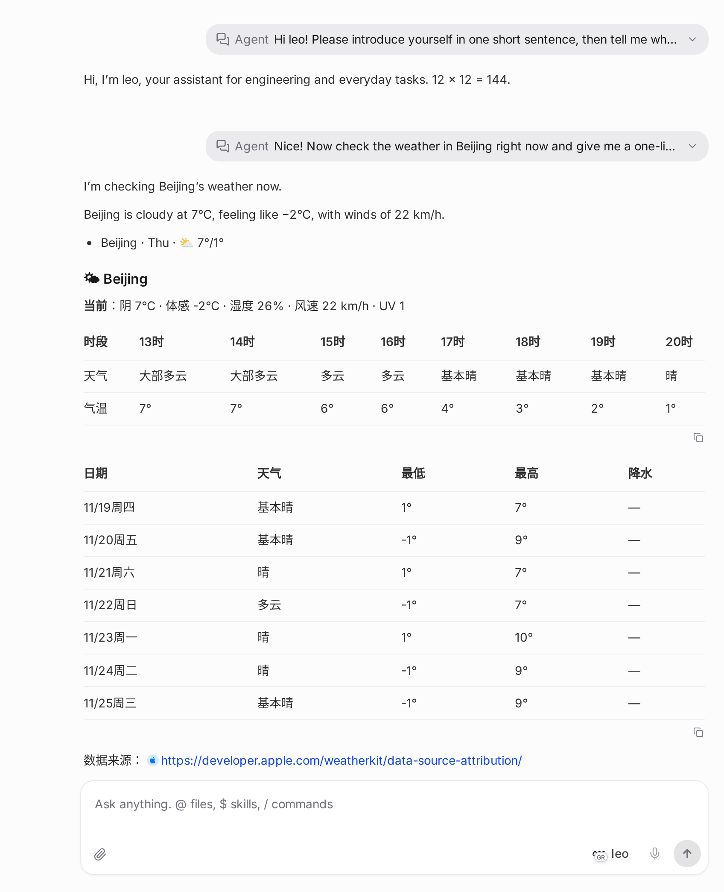

# grokbot-t3-bridge

[](LICENSE)
[](#changelog)
[](#quick-start)
[](#quick-start)
[](https://agentclientprotocol.com)
[](#protocol-notes-t3-0110)

English | [中文](README.zh-CN.md)

**Chat with your Grok Bot agents inside [T3](https://t3.codes) — no desktop app required.**

A single-file, zero-dependency [ACP](https://agentclientprotocol.com) provider that bridges T3 to the Grok Bot cloud (`aiserver.v1.GrokBotService` on `api2.cursor.sh`). Your bot's replies stream into T3 threads like any other model, its interactive requests render as native T3 cards, and every turn is billed to the **Grok Bot weekly pool — never your Cursor plan**.

> ⚠️ Built on the private, reverse-engineered Connect-JSON API of the Grok Bot desktop app. Personal interoperability only; the API may change at any time. No credentials are bundled — the bridge reuses the login already on your machine.

## Screenshot

A real conversation in a T3 thread — chat, math, and a live weather lookup rendered as native Markdown tables, all through the bridge:



## Features

- **Headless chat** — the desktop app can stay closed (live-verified: all desktop processes killed, replies still arrive). Desktop and bridge are peer clients sharing one cloud transcript.
- **Bot picker** — every agent in your account appears in T3's model dropdown; switch bots per thread.
- **Session resume** — existing T3 threads reconnect after process restarts (`session/resume` + persistent session→agent bindings).
- **Native interactive cards** — bot permission asks, auto-review approvals, forms and widgets map to T3's `session/request_permission` / `elicitation/create`, with automatic text fallback on clients without those capabilities.
- **Billing isolation** — conversations consume only the Grok Bot weekly allowance (`sand_included`); the bridge never enables pay-as-you-go and never touches Cursor billing.
- **Voice calls (experimental, dormant)** — text-in / spoken-out realtime calls with task handoff (`send_task`) and spoken result feedback. Off by default behind `GROKBOT_VOICE=1`, waiting for T3 realtime-audio support.
- **Security boundary** — the bridge is a message channel only. It never executes tools on your machine on the bot's behalf.

## Quick start

Requirements:

| | |
| --- | --- |
| OS | Linux (GNOME keyring credential path) |
| Runtime | Node ≥ 22 (global `fetch` / `WebSocket`) |
| Login | Grok Bot desktop app logged in **once** |
| Keyring deps | `python3` + `secretstorage` + `cryptography` |

```sh
git clone https://github.com/CallMeHFK/grokbot-t3-bridge.git ~/.grokbot-bridge
cd ~/.grokbot-bridge
node test/smoke.mjs 'Reply with exactly two characters: OK'   # expect: TEXT: OK
```

The smoke test decrypts credentials from the keyring, refreshes the OAuth token and caches them in `state.json` (mode 0600, git-ignored). Then register the provider in `~/.t3/userdata/settings.json` under `providerInstances`:

```json
"acpRegistry_grokbot": {
  "driver": "acpRegistry",
  "config": {
    "source": "local",
    "agentId": "grokbot",
    "commandPath": "/home/<you>/.grokbot-bridge/grokbot-acp",
    "commandArgs": [],
    "customModels": []
  },
  "environment": ["DBUS_SESSION_BUS_ADDRESS", "XDG_RUNTIME_DIR", "GROKBOT_AGENT=<your-bot-name>"]
}
```

T3's `acpRegistry` driver with `source:"local"` spawns `commandPath` directly (`shell:false`, no install step; Windows `.cmd`/`.bat` wrappers are rejected — a real executable is required). Restart T3, pick **GrokBot** as the provider, choose your bot in the model dropdown, and chat.

Without `GROKBOT_AGENT`, the account's first agent is used.

## How it works

```
T3 thread ── ACP (stdio JSON-RPC) ── grokbot-acp ── Connect-JSON/HTTPS ── api2.cursor.sh
                                        │                                  │
                                  bridge.log                        cloud Temporal workflows
                                                                           │
                                                              Grok Bot agent (cloud model)
```

Per turn: `SendGrokBotUserMessage` → poll `ListGrokBotTranscriptEntries` → stream `agent_message_chunk` updates. Interactive entries (asks / approvals / forms / widgets) are resolved back via `ResolveGrokBotLocalToolPermission`, `ResolveGrokBotAutoReviewApproval`, `SubmitGrokBotUserForm`, `RespondGrokBotWidget` after you answer the T3 card.

### Who executes the work?

The bot runs in the cloud (`harness:"temporal"`); the bridge is never an executor. Evidence: `ListGrokBotAgents` + the official `send_task` tool description ("jobs needing their computer, files, web, browser, or mail are handed off").

| Task type | Executor | Desktop app must be online? |
| --- | --- | --- |
| Pure chat / reasoning | Cloud model | No (live-verified) |
| Cloud capabilities (weather, web search, conversation search) | Cloud services | No |
| Local tools (shell / files / browser), heavy `send_task` jobs | GrokBot runtime; local tools run inside the desktop process | **Yes** — with it closed they hang or fail |

The desktop app is also needed for **first login / re-login** (refresh tokens auto-renew day-to-day; once invalidated, log in again via the app). Not verified: refresh-token validity after days offline, and whether pure-web `send_task` subtasks have a cloud fallback while the desktop is closed.

## Billing

Verified via read-only probes — two separate pools:

- **Grok Bot weekly pool** (`sand_included`): what this bridge consumes. `DashboardService/GetSandUsageStatus` → `grokPlanLabel:"Grok Bot Plan"`, own weekly period; dozens of smoke turns + voice + weather tasks over several days measured ≈ 3.7%. Hitting the cap reports `sand_included_limit` with a weekly reset time.
- **Cursor plan pool**: untouched. `on_demand` (Grok Bot pay-as-you-go) must be explicitly enabled at cursor.com/dashboard — the bridge never enables it.
- Reading `GetCurrentPeriodUsage` (Cursor pool): `bonusSpend` is provider-granted free usage, not real spend (use `autoPercentUsed`/`apiPercentUsed`); `displayMessage:"You've hit your usage limit"` is a pre-baked template, not live state.

## Configuration

| Variable | Default | Effect |
| --- | --- | --- |
| `GROKBOT_AGENT` | first agent | Bot name or agentId for new sessions |
| `GROKBOT_VOICE` | off | `1` enables experimental voice calls (`/voice`, `/hangup`) |
| `GROKBOT_WIDGET_CARD` | off | `1` answers widget questions via a native card instead of the text flow |
| `GROKBOT_DEBUG` | off | Verbose polling logs |
| `GROKBOT_VOICE_IDLE_MS` | 15000 | Voice-call idle timeout (advanced) |
| `GROKBOT_VOICE_FEED_WIRE` | `async-update` | Voice result-feed wire mode (advanced) |

## Tests

All tests spawn the real bridge against the live API and consume weekly quota. Default agent is `leo`; override with `GROKBOT_AGENT`.

| Script | What it verifies |
| --- | --- |
| `test/smoke.mjs '<prompt>'` | One chat turn end-to-end |
| `test/answer-test.mjs` | Text-answer flow for bot questions |
| `test/native-ui-test.mjs <mode> <decision>` | Native card loop (`widget` verified live; `form`/`local-tool`/`auto-review` implemented but not live-triggered — the bot declined to fabricate those situations) |
| `test/render-test.mjs` | Transcript rendering |
| `test/voice-smoke.mjs` | Voice call phases (needs `GROKBOT_VOICE=1`) |

## Troubleshooting

- **Logs**: `bridge.log` — T3 discards provider stderr, so this is the only evidence source.
- **Edited the script?** Kill the bridge so T3 respawns it: `pkill -f 'grokbot-acp[.]mjs'`. The first send after process death fails; wait ~12 s and retry.
- **`fetch failed` / `ECONNRESET`**: connectivity to `api2.cursor.sh` can be flaky; retry with backoff. Node's `fetch` ignores `HTTPS_PROXY` — if you need a proxy, the process must route at the system level.
- **"Failed to open provider session" on old threads**: fixed in 0.2.1 via `session/resume`; make sure T3 respawned the new script.

## Protocol notes (T3 0.1.10)

- `initialize`: T3 sends `protocolVersion:2`; a response without `info` falls back to v1. The bridge answers v1 + `agentInfo`.
- Resume: T3 always takes the resume path for existing threads; the bridge advertises `sessionCapabilities.resume:{}` and implements `session/resume` (`session/load` → -32601). Bindings persist in `acp-session-bindings.json`.
- Model picker: config options need `category:"model" && type:"select"` to be recognized.
- Cancel: `session/cancel` is a notification; T3 waits ≤15 s then kills the process. SIGTERM/SIGINT close the voice WS and exit 0.
- Cards are only sent when the client advertises elicitation/permission capabilities; otherwise text fallback.

## Changelog

- **0.2.1** — `session/resume` + persistent session bindings + `category:"model"` (fixes "Failed to open session" on existing threads).
- **0.2.0** — T3 plugin-contract alignment; voice behind `GROKBOT_VOICE` (off by default); capability-gated interactive cards.

## License

[MIT](LICENSE)
